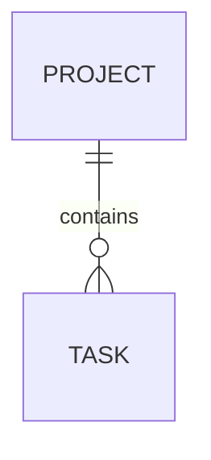

# Week Five data model

The application stores projects and their tasks in SQLite. `schema/001_initial.sql`
defines the initial schema.

## Tables

### `Project`

| Field | Type | Constraints |
|---|---|---|
| `id` | `INTEGER` | Primary key |
| `name` | `TEXT` | Required and unique |
| `created_at` | `TEXT` | Required; defaults to `CURRENT_TIMESTAMP` |

### `Task`

| Field | Type | Constraints |
|---|---|---|
| `id` | `INTEGER` | Primary key |
| `project_id` | `INTEGER` | Required foreign key to `Project.id` |
| `title` | `TEXT` | Required; 1 to 200 characters |
| `status` | `TEXT` | Required; defaults to `todo`; limited to `todo`, `in_progress`, or `done` |
| `due_date` | `TEXT` | Optional |

One project can contain zero or many tasks. Every task belongs to one project.
Deleting a project that still has tasks is restricted, so existing tasks are
not accidentally orphaned or removed. The application does not currently offer
a project-deletion action.

